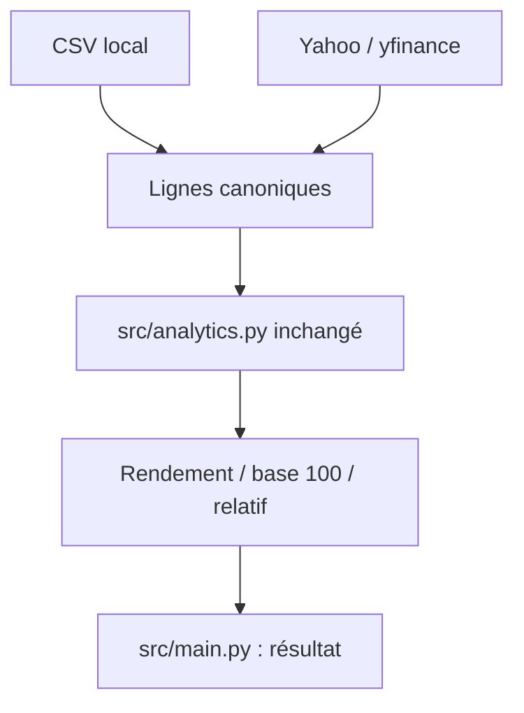

# 05 - TD08 : Yahoo Finance après la validation de TD07

**Notebook :** [02_yahoo_provider.ipynb](../notebooks/02_yahoo_provider.ipynb)  
**Guide CORE officiel :** [TD08 - Yahoo Finance](../docs/labs/TD08_YAHOO_FINANCE.md)  
**Issue de référence :** [Starter #40](https://github.com/tawounfouet/esilv-marketpulse-starter/issues/40)

## Porte de démarrage (GO / NO-GO)

**GO** seulement si la feature TD07 Analytics est :

- relue et fusionnée dans le `main` de l'équipe ;
- exécutable avec `python src/main.py` ;
- cohérente sur les mêmes dates instrument / benchmark.

**NO-GO** : revenir à TD07 et garder TD08 à l'état d'introduction ou de planification. Ne pas créer une nouvelle branche TD08 si l'Issue et ses rôles ne sont pas prêts.

## L'architecture à comprendre

Le provider s'occupe de l'acquisition et de la conversion au contrat commun. Les analytics **n'ont pas besoin de connaître la source**.

## Étapes d'une première exploration

1. Lire notebook 02 et comprendre l'exemple `yf.Ticker("AAPL").history(period="1mo", interval="1d")`. Cette lecture peut avoir lieu avant toute nouvelle branche.
2. **Dans votre dépôt d'équipe**, ouvrir l'Issue TD08, y déclarer la dépendance TD07, attribuer le Developer, désigner un Reviewer distinct et confirmer le GO TD07. **Créer seulement alors** la branche TD08 depuis `main` à jour.
3. Installer `yfinance` si nécessaire sur cette branche, puis déclarer la dépendance dans `requirements.txt` si la feature TD08 est effectivement démarrée.
4. Créer `src/providers/__init__.py` puis `src/providers/yahoo_provider.py`.
5. Mettre en place le mapping `AAPL -> AAPL` et `SP500 -> ^GSPC`.
6. Obtenir les lignes canoniques pour l'instrument AAPL et le benchmark SP500 : `date,ticker,open,high,low,close,volume`.
7. Conserver `SP500` comme identifiant métier dans la sortie, même si le fournisseur utilise `^GSPC`.
8. Réutiliser les calculs TD07 **sans changer `analytics.py`**, puis soumettre une PR liée à l'Issue et demander une vraie review selon le [workflow de collaboration](02_BRANCH_PR_CODE_REVIEW.md).

**Note :** `yfinance` est une bibliothèque communautaire, ce n'est pas une API officielle Yahoo. Les valeurs de marché et la structure exacte de la réponse peuvent varier.

## Vérification attendue au terme du vrai TD08

- [ ] AAPL et SP500 récupérés depuis Yahoo sur la **même période (1 mois) et fréquence (Daily)**.
- [ ] Les lignes normalisées possèdent les sept champs canoniques, avec les bons types.
- [ ] L'instrument et le benchmark sont alignés.
- [ ] Les fonctions TD07 sont réutilisées sans logique Yahoo à l'intérieur.
- [ ] `python src/main.py` exécute la nouvelle source si Yahoo est accessible.
- [ ] La PR d'équipe a été relue et intégrée dans `main`.
- [ ] Les preuves Checkpoint B sont authentiques et individuelles.

## Et si Yahoo est indisponible ?

Décrire les symptômes, conserver le travail local utile et notifier l'instructeur. Le [contrat des checkpoints](../docs/04_CHECKPOINTS_AND_EVIDENCE.md) prévoit `PENDING_EXTERNAL` pour une indisponibilité externe documentée lors du checkpoint, **pas** comme remplacement d'un travail étudiant manquant.

**Interdiction :** présenter un CSV pédagogique comme une capture de données Yahoo récupérées en direct.

**Pour la séance du 27 novembre :** TD08 est une amorce conditionnelle. Sa validation complète interviendra lorsque toutes les exigences du guide seront réellement satisfaites.
