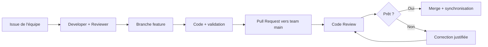

# Collaboration GitHub | MarketPulse

**Espace public pour les étudiants ESILV A4 - Python, Git, Linux.**

Séance IF5 du **vendredi 27 novembre 2026**, de **13h30 à 16h45** (pause 15h00-15h15). Ces fiches restent réutilisables pour les autres groupes et pour préparer le projet final.

> **Objectif :** organiser le travail d'une équipe de développeurs et construire progressivement MarketPulse. Nous réutilisons Git et GitHub pendant TD07 et TD08, au lieu de terminer Git avant de passer aux données financières.

## Rappel actif TD01-TD06 (13h30-13h50)

Après un mois sans séance IF5, nous commençons par une **réactivation formative, non notée**, des fondations Linux, Python, Git et GitHub.

**Nouveau : [refresh/ - scripts Bash/Python et modèles mentaux](refresh/README.md)**. Ce laboratoire est exécutable dans Codespaces ou Linux :

```bash
bash collaboration/refresh/scripts/run_refresh.sh
```

Le parcours court est en lecture seule. Des simulations TD03/TD04 dans des dépôts temporaires sont disponibles avec `--labs`, et les aides TD05/TD06 sont en lecture seule. Aucun script ne crée une PR, n'approuve un code ni ne fusionne dans le dépôt d'équipe.

## À faire maintenant (5 minutes)

1. Ouvrir le **fork partagé de votre équipe**, pas le Starter de l'instructeur.
2. Vérifier la branche `main`, l'état des PR et les accès de vos collaborateurs.
3. Si nécessaire, demander au propriétaire d'activer **Settings > General > Features > Issues**.
4. Créer une **Issue TD07 dans votre dépôt d'équipe** avec [le modèle fourni](templates/ISSUE_FEATURE.md).
5. Choisir un **Developer (Assignee)** et un **Reviewer prévu** distinct avant de créer la branche.

**Ne déposez pas vos nouvelles PR étudiantes sur ce Starter.** Vos Issues, branches, PR, revues et merges appartiennent à **votre fork d'équipe**. Les Issues [#39 (TD07)](https://github.com/tawounfouet/esilv-marketpulse-starter/issues/39) et [#40 (TD08)](https://github.com/tawounfouet/esilv-marketpulse-starter/issues/40) sont des **références pédagogiques**, pas vos tickets opérationnels.

## Parcours de la séance

| Heure | Atelier | Ce que vous devez montrer |
| --- | --- | --- |
| 13h30-13h50 | [Refresh TD01-TD06](refresh/README.md) | Questions flash + diagnostic Git/Linux/Python |
| 13h50-14h05 | [Issues et rôles](01_ISSUES_ET_ROLES.md) | Issue TD07 créée, Developer et Reviewer prévus |
| 14h05-14h20 | [PR et Code Review](02_BRANCH_PR_CODE_REVIEW.md) | Diff inspecté, retour technique argumenté |
| 14h20-14h50 | [Conflit Git contrôlé](03_LAB_CONFLITS_GIT.md) | Conflit compris et résolu en dépôt jetable |
| 14h50-15h00 | [TD07 - notebook 01](04_TD07_ANALYTICS.md) | Alignement et calcul financier compris |
| 15h00-15h15 | Pause | |
| 15h15-15h55 | [TD07 - développement](04_TD07_ANALYTICS.md) | `analytics.py` + intégration en cours |
| 15h55-16h15 | [PR / Review TD07](02_BRANCH_PR_CODE_REVIEW.md) | PR examinée ; merge seulement si prête |
| 16h15-16h35 | [TD08 - Yahoo Finance](05_TD08_YAHOO.md) | Démarrage seulement si TD07 est validé, sinon consolidation |
| 16h35-16h45 | [Bilan et preuves](06_PREUVES_ET_BILAN.md) | Liens, démonstrations et prochain blocage |

La séance combine des activités **CORE** et un mini-lab **ADVANCED** guidé. Terminer tout TD07 et TD08 aujourd'hui n'est pas obligatoire si le socle n'est pas prêt.

## Le workflow que nous répéterons



**Règles :** aucune nouvelle branche de fonctionnalité sans Issue définie et rôles attribués. Pas de modification directe de `main` pour une feature. Pas de merge sans vraie revue. Une revue ne doit pas produire un faux défaut ou un commit inutile.

## Guides et modèles

| Ressource | Usage |
| --- | --- |
| [00 - Refresh TD01-TD06](refresh/README.md) | Bash/Python commentés, modèles mentaux et vérifications sans risque |
| [01 - Issues et rôles](01_ISSUES_ET_ROLES.md) | Configurer les équipes et préparer une feature |
| [02 - Branche, PR et Code Review](02_BRANCH_PR_CODE_REVIEW.md) | Réaliser et examiner une contribution |
| [03 - Résolution de conflits](03_LAB_CONFLITS_GIT.md) | Mini-lab exécutable et sûr |
| [04 - TD07 Analytics](04_TD07_ANALYTICS.md) | Notebook 01, normalisation, base 100 |
| [05 - TD08 Yahoo](05_TD08_YAHOO.md) | Notebook 02, provider canonique et dépendances |
| [06 - Preuves et bilan](06_PREUVES_ET_BILAN.md) | Exit ticket, captures officielles et suite |
| [07 - Dépannage](07_DEPANNAGE.md) | Blocages Git/GitHub, Python, Yahoo |
| [Modèle Issue](templates/ISSUE_FEATURE.md) | Description de fonctionnalité à copier |
| [Modèle PR](templates/PULL_REQUEST.md) | Description d'une Pull Request à copier |
| [Guide de review](templates/REVIEW_GUIDE.md) | Questions et exemples de commentaires |

## Ressources officielles du Starter

- [TD06 - Code Review](../docs/labs/TD06_CODE_REVIEW.md)
- [ADV-GIT-01 - Conflict Resolution](../docs/advanced/ADV_GIT_01_CONFLICT_RESOLUTION.md)
- [TD07 - Data Normalization + Comparison](../docs/labs/TD07_DATA_NORMALIZATION_AND_COMPARISON.md)
- [TD08 - Yahoo Finance](../docs/labs/TD08_YAHOO_FINANCE.md)
- [Notebooks 01-05](../notebooks/README.md)
- [Checkpoint and Evidence - contrat faisant autorité](../docs/04_CHECKPOINTS_AND_EVIDENCE.md)
- [CONTRIBUTING - règles Git générales](../CONTRIBUTING.md)

## Après cette séance : projet final

Les TD se font dans **un fork partagé du Starter**. Le projet final envisagé vise **un nouveau dépôt vierge**, dans lequel chaque équipe devra reconstruire MarketPulse et organiser ses Issues, branches, PR, revues et releases. Les modalités définitives du projet final restent soumises à validation pédagogique.

**Confidentialité :** ne publiez ni identifiants scolaires, ni photos, ni notes, ni mots de passe, ni jetons GitHub, ni accès Bloomberg dans ce dépôt public.
